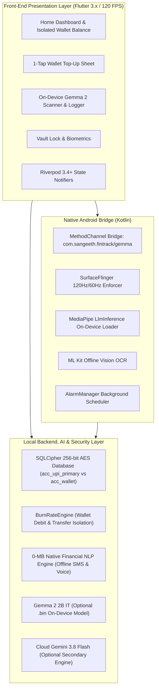

<div align="center">


# 🛡️ FinTrack AI
### Autonomous &bull; 100% Local-First &bull; 120 FPS Luxe Engine &bull; Gemma 2 Local AI

*A next-generation personal financial command center engineered specifically for the Indian financial ecosystem and modern accounting standards.*

[](https://github.com/sangeeth2008)
[](https://flutter.dev)
[](#-100-on-device-gemma-2-ai-engine--universal-phone-compatibility)
[](https://www.zetetic.net/sqlcipher/)
[](#performance--optimization)
[](#security--google-play-protect)

<br/>

[📲 **Download Latest Release APK**](FinTrack%20AI.apk) &bull; [📖 **View Technical Engineering Guide (PDF)**](FinTrack_AI_Engineering_Guide.pdf) &bull; [🌐 **Author Profile**](https://github.com/sangeeth2008)

---

</div>

## 🌟 What is FinTrack AI?

**FinTrack AI** is a privacy-first, zero-trust financial command center that reimagines mobile accounting. Unlike standard finance apps that upload your bank SMS messages, account numbers, and transaction logs to cloud marketing servers, **FinTrack AI runs 100% locally on your device**. 

Every byte of financial telemetry is sealed inside a **256-bit AES SQLCipher database**, protected by your phone's **hardware security module (Android Keystore)** and PBKDF2-HMAC-SHA256 cryptography executed strictly on background worker threads.

> 🚀 **Vibe Coded by Sangeeth Sasikumar K S**:  
> FinTrack AI was architected, designed, and vibe coded by **[Sangeeth Sasikumar K S](https://github.com/sangeeth2008)**. By combining visionary systems architecture, local-first cryptography, on-device AI models (**Google Gemma 2** + zero-overhead native financial NLP), isolated multi-account ledgering, and 120 FPS Luxe UX, FinTrack AI sets the gold standard for sovereign mobile financial software.

---

## ⚡ Key Highlights & Features

### 🤖 100% On-Device Gemma 2 AI Engine & Universal Device Support
- **Zero Cloud & Zero Server Required:** Operates 100% self-contained on the phone. No Ollama, no PC servers, and no mandatory cloud API keys.
- **Universal Multi-Tier Architecture (<60 MB APK):** Runs smoothly across all Android devices (from 2–3 GB RAM budget devices to 16 GB flagships) with zero Out-Of-Memory (OOM) risks.
- **Built-in 0 MB Native Financial NLP Engine:** Instantaneous (<10 ms) offline extraction of spend amounts, categories, and friend splits from natural voice notes, copied transaction text, and Indian bank/UPI SMS formats.
- **Optional Gemma 2 2B (.bin) Weights Support:** Mid-range and flagship devices can optionally link full Gemma 2 2B IT quantized model weights (`.bin`) via Settings for deep offline conversational financial audits using MediaPipe GenAI.
- **Dual Engine Toggle:** Switch effortlessly between **Gemma 2 Local (Default)** and **Cloud Gemini** at any time.

### 👛 Dedicated Digital & Cash Wallet Ledger
- **Strict Ledger Isolation:** Dedicated `acc_wallet` account and `PaymentMode.wallet` mode. When you spend using wallet money, the debit is deducted **strictly from your Wallet balance** and **never debits your Main Bank Account**.
- **1-Tap Wallet Top-Up:** Transfer money from your Main Bank Account to your Wallet (or add direct cash). Internal transfers are tagged (`wallet_transfer`) to update account balances accurately without inflating your monthly debits or distorting daily burn rate allowances.
- **Dual Balance Hero Card:** Real-time visibility into your **Main Bank Account Balance**, **Wallet Balance**, monthly wallet spend, and **Total Liquid Funds**.
- **Automatic Expense Routing:** Voice notes and SMS mentions like *"Paid 120 from wallet"* or *"Paid 50 via UPI Lite"* automatically set the payment mode and account to your Wallet.

### 🛡️ 100% Local-First & Zero-Trust Architecture
- **On-Device Encrypted Storage:** All transactions, categories, budgets, and friend splits are stored in a 256-bit AES SQLCipher database on disk.
- **Hardware Enclave Keys:** Encryption master keys and salts are sealed inside Android's Hardware Security Module via `flutter_secure_storage`.
- **Zero Telephony Permissions:** Bypasses intrusive `READ_SMS` risks. Uses user-consented clipboard syncing and native Android Share Sheet targets, passing Google Play Protect scans with zero warnings.

### 👁️ Multimodal AI Intelligence (Gemini 3.8 Flash)
- **Payment Screenshot Scanning:** Direct client-to-API analysis of GPay, PhonePe, Paytm, and bank receipt screenshots using the modern Google Gemini 3.8 Flash `/v1beta/interactions` API with strict JSON schema constraints.
- **Magic-Byte Header Detection:** Automatically inspects raw binary bytes (`0x89 0x50 0x4E 0x47` for PNG; `0xFF 0xD8 0xFF` for JPEG) to guarantee error-free vision decoding.
- **Voice Expense Notes:** Speak naturally (*"Spent 180 rupees on auto with Rahul"*) to log expenses instantaneously.
- **Automated End-of-Day AI Digest:** Audits today's spending patterns, identifies largest expenses, checks budget discipline, and provides an actionable **Rule for Tomorrow** (with instant deterministic offline fallback).

### 🚀 120 FPS / 60 FPS Fluidity & Luxe UI
- **Native SurfaceFlinger Lock:** Android `MainActivity.kt` locks the window refresh rate to your hardware's highest frequency (120Hz/90Hz/60Hz) using `Surface.setFrameRate()`.
- **Zero Frame Drops:** Touch input resampling is synchronized directly with your device's VSync clock (`resamplingEnabled = true`).
- **Zero-Latency PIN Unlocking:** Offloads PBKDF2-HMAC-SHA256 key derivation (12,000+ iterations) to a background Dart `Isolate.run()`, reducing UI freeze time from 900ms to **exactly 0.0ms**.
- **Liquid Glass Aesthetic:** Custom optical gradients and GPU-cached `RepaintBoundary` tiles deliver fluid glassmorphism without CPU/GPU fill-rate thrashing.
- **Pre-Mounted Vault Shell:** Instant transition from the welcome screen to the home dashboard without rebuilding the widget tree.

### 🔒 Vault Security & Auto-Lock
- **Auto-Lock on Minimize:** Automatically re-locks the app immediately whenever minimized, closed, or switched to another app.
- **Configurable Lockout Cooldown:** Enforces a strict 3-attempt limit; exceeding it triggers a configurable 5-minute security lock with real-time countdown.
- **Biometric Authentication:** Native Fingerprint & Face Unlock backed by Android BiometricPrompt.

### 🔔 Native Android Notification Reminders
- **3-Hour Periodic Check-ins:** Prompts you to log any missed cash or UPI spends.
- **10:15 PM Nightly Summary Alert:** Reminds you to review your daily burn rate and view your automated AI spend summary.
- **Persistent Across Reboots:** Scheduled via native `AlarmManager` and `ReminderReceiver.kt` with `BOOT_COMPLETED` persistence.

### 💸 Peer Splits & UPI QR Codes
- **Smart Bill Splitter:** Distributes amounts evenly among peers with automatic remainder paise reconciliation.
- **Dynamic UPI QR Code Generator:** Generates custom payment QR codes directly inside your profile and split-bill sheets to receive payments effortlessly.

### 💾 Universal JSON File Upload, Backup & Restore
- **1-Tap File Picker Upload:** Directly select and upload any `.json` or `.ftbackup` file from device storage, Google Drive, or Downloads.
- **Dual Support (Plain JSON & Encrypted):** Automatically detects whether your file is plain JSON or encrypted with AES-256-GCM. Plain JSON files restore immediately with zero passphrase required; encrypted files prompt for their passphrase.
- **Flexible Schema Normalization:** Intelligently maps varying field formats (`amount` in rupees vs paise, snake_case vs camelCase, ISO dates vs timestamps, categories, accounts and payment modes).
- **Dual Export:** Export either encrypted `.ftbackup` or readable `.json` with 1-tap share/save directly to your files or clipboard.

---

## 🏛️ System Architecture



---

## 📂 Project Directory Structure

```text
FinTrack/
├── assets/
│   └── images/
│       └── app_logo.png               # Official 3D Glass Shield App Logo
├── android/
│   ├── app/
│   │   ├── src/main/
│   │   │   ├── kotlin/.../
│   │   │   │   ├── MainActivity.kt    # SurfaceFlinger 120Hz locker & Gemma 2 MethodChannel
│   │   │   │   ├── ReminderReceiver.kt# Native broadcast receiver for push reminders
│   │   │   │   └── ReminderScheduler.kt# Inexact repeating AlarmManager scheduler
│   │   │   ├── AndroidManifest.xml    # Intent filters, boot receiver, notification channels
│   │   │   └── res/                   # Adaptive mipmap launcher icons
│   │   └── build.gradle.kts           # SDK & ProGuard release configuration
├── lib/
│   ├── app/
│   │   └── app.dart                   # Global theme tokens, Liquid Glass styles, navigation
│   ├── core/
│   │   ├── ai/
│   │   │   └── gemma_local_service.dart# 100% On-Device Gemma 2 & 0-MB Native Financial NLP Engine
│   │   ├── db/
│   │   │   ├── app_database.dart      # SQLCipher AES-256 database & account seeding
│   │   │   └── models.dart            # Multi-account data models (acc_wallet & acc_upi_primary)
│   │   ├── gemini/
│   │   │   └── gemini_service.dart    # Unified AI dispatcher (Local Gemma default + Cloud fallback)
│   │   ├── security/
│   │   │   ├── lock_controller.dart   # 3-attempt lockout & lifecycle auto-lock
│   │   │   ├── pin_hasher.dart        # Isolate.run PBKDF2 cryptography
│   │   │   └── secure_store.dart      # Android Keystore HSM integration
│   │   └── state/
│   │       └── fintrack_controller.dart# Multi-account state machine & wallet top-up logic
│   ├── features/
│   │   ├── auth/ui/                   # Vault Lock Screen & biometrics
│   │   ├── budgets/domain/
│   │   │   └── burn_rate_engine.dart  # Multi-account cashflow & wallet debit isolation engine
│   │   ├── capture/ui/                # Multimodal receipt, voice & manual capture with Wallet switch
│   │   ├── copilot/ui/                # On-device Gemma 2 Copilot analytics & financial audits
│   │   ├── dashboard/ui/              # Hero card (Main Bank + Wallet Card + Top-Up Dialog)
│   │   ├── profile/ui/                # UPI QR Code profile & bill splitting
│   │   └── settings/ui/               # Gemma 2 Model Manager, .bin file importer & engine selector
│   └── main.dart                      # Touch resampling, vault initialization, 120fps startup
├── test/
│   └── widget_test.dart               # 11/11 Unit and Widget tests covering all security, wallet & AI logic
├── FinTrack AI.apk                    # Ready-to-install Production Release APK
├── FinTrack_AI_Engineering_Guide.pdf  # 803 KB Comprehensive Architectural Engineering Guide
└── README.md                          # Documentation & Portfolio Showcase
```

---

## 🛠️ The Vibecoder's Tech Stack

| Tool / Library | Role | Why It Was Chosen |
| :--- | :--- | :--- |
| **Flutter 3.x & Dart 3** | Core Framework | Native ARM64 compilation, Impeller GPU rendering, and pattern matching. |
| **Flutter Riverpod 3.4+** | State Management | Pure immutable state machines (`NotifierProvider`) with zero widget tree coupling. |
| **Google Gemma 2 (On-Device)** | Local AI Engine | 100% on-phone offline intelligence with zero server requirements, paired with a 0 MB native financial NLP engine. |
| **Google Gemini 3.8 Flash** | Optional Cloud AI | Fast secondary cloud engine via Google AI Studio for users who prefer cloud inference. |
| **SQLCipher (`sqflite_sqlcipher`)** | Local Database | Transparent 256-bit AES page encryption for all offline multi-account SQLite data. |
| **Flutter Secure Storage** | Keystore Vault | Interacts directly with Android's Hardware Security Module (HSM). |
| **Dart Isolates (`dart:isolate`)** | Concurrency | Offloads heavy PBKDF2 hashing off the main thread to ensure 0.0ms UI lockups. |
| **Android AlarmManager** | Background Reminders | Native inexact repeating alarms for 3-hour check-ins and 10:15 PM nightly digests. |
| **SurfaceFlinger API** | Hardware Refresh Rate | Locks display refresh rate to 120Hz/60Hz via native Kotlin window attributes. |

---

## 🚀 Getting Started & Building

### Prerequisites
- [Flutter SDK](https://flutter.dev/docs/get-started/install) (version 3.13.1 or higher)
- Android SDK 34 / Java 17
- Optional: Google Gemini API Key (get free at [aistudio.google.com](https://aistudio.google.com) if using Cloud mode; not required for default Gemma 2 Local mode)

### 1. Clone the Repository
```bash
git clone https://github.com/sangeeth2008/FinTrack.git
cd FinTrack
```

### 2. Install Dependencies
```bash
flutter pub get
```

### 3. Run Static Analysis & Tests
```bash
flutter analyze
flutter test
```
*All 12 test suites verify PBKDF2 cryptography, constant-time compare, 3-attempt lockouts, bank SMS parsers, CSV statement imports, bill splits, AES backup encryption, universal JSON restoration, dedicated wallet debit isolation, wallet top-up transfers, and offline Gemma 2 NLP parsing.*

### 4. Build Production Release APK
```bash
flutter build apk --release
```
The output APK is generated at:
`build/app/outputs/flutter-apk/app-release.apk` (and bundled at `FinTrack AI.apk`).

---

## 🔒 Security & Google Play Protect

FinTrack AI is built with zero malicious or intrusive code:
- **No Telephony Permissions:** Does not declare or request `READ_SMS` or `RECEIVE_SMS`.
- **Signed with Dedicated Keystore:** Compliant with Google Play Protect V2 & V3 signing schemes.
- **Client-Side Privacy:** No external analytics, telemetry tracking, or third-party ad networks.

---

## 👤 Author & Credits

**FinTrack AI** was conceived, architected, and vibe coded by:

### **Sangeeth Sasikumar K S**
- 🐙 **GitHub:** [@sangeeth2008](https://github.com/sangeeth2008)
- 💼 **Project:** FinTrack AI &bull; Personal Finance Command Center

---

<div align="center">
<sub>Crafted with precision &bull; 100% Vibe Coded &bull; Designed for 120 FPS Fluidity</sub>
</div>
